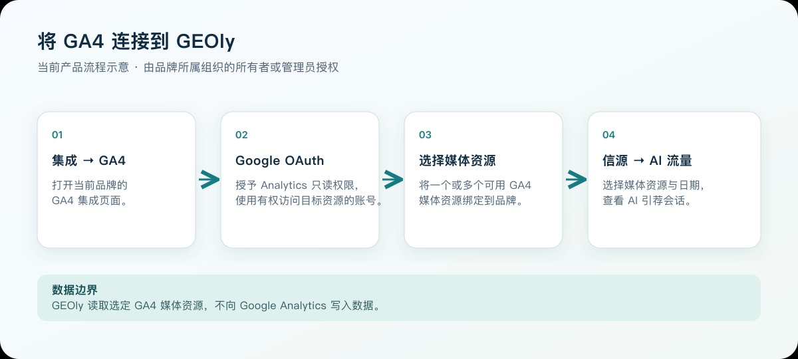
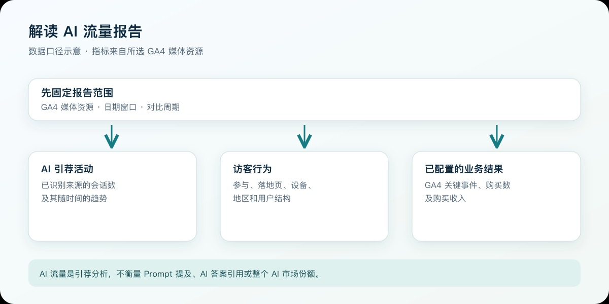

Google Analytics 4（GA4）集成用于观察“AI 平台带来了多少真实网站访问，以及这些访问产生了怎样的参与和转化”。授权后，Geoly 通过 Google Analytics Admin API 读取当前账号可访问的账号与媒体资源列表，并通过 Google Analytics Data API 读取你选定媒体资源的报表数据。整个流程使用只读权限，不会修改属性、事件、受众或历史数据。

> GA4 记录的是浏览器端会话与行为，不记录 AI 爬虫抓取。若要分析 AI 爬虫访问，请同时连接 Cloudflare。

## 一、授权前准备

开始前请确认：

- 当前账号是所选组织的所有者或管理员；
- 用于授权的 Google 账号能访问目标 GA4 媒体资源；
- 你知道要绑定的品牌、网站和 GA4 媒体资源；
- 目标网站已经正确安装 GA4，且 GA4 中能看到数据。

如果 Google 账号可以登录但看不到目标媒体资源，需要先由 GA4 管理员为该账号授予相应的读取权限。

## 二、从 Geoly 发起 GA4 授权

先选择要分析的品牌，打开 **集成 → GA4**。也可从 **信源 → AI 流量** 的 Google Analytics 数据源入口进入连接页。点击 **连接 Google Analytics** 后，GEOly 会跳转到 Google OAuth 流程。

这张图说明当前连接路径，是示意图，不是应用界面截图。

Geoly 请求的核心权限是 Google Analytics 只读权限。该权限用于读取报表数据，不能编辑 GA4 配置，也不能写入或删除事件。

## 三、完成 Google OAuth 授权

1. 选择拥有目标 GA4 媒体资源权限的 Google 账号；
2. 查看授权应用与只读权限说明；
3. 同意授权并返回 Geoly；
4. 如果使用了错误账号，可返回后重新发起授权。

授权流程中不要把验证码、恢复码或账号密码发给任何人。Geoly 使用 OAuth 完成授权，不需要你向 Geoly 提供 Google 密码。

## 四、选择 GA4 账号与媒体资源

OAuth 成功后，Geoly 会读取当前 Google 账号可访问的 GA4 账号和媒体资源，并显示选择界面。

- 可以选择一个或多个媒体资源；
- 第一个选中的媒体资源作为主要媒体资源；
- 其余选中的媒体资源会被保存为允许访问的范围；
- 只能查询本次已选择并授权的媒体资源；
- 连接会绑定到当前 Geoly 品牌。

选择时请优先核对媒体资源名称、网站域名和业务环境，避免把测试站、旧站或其他地区站点绑定到当前品牌。

## 五、授权后在哪里查看数据

完成媒体资源绑定后，系统会进入 **信源 → AI 流量**，切换到 GA4 数据。

GA4 连接成功后，如果本次授权选择了多个媒体资源，页面顶部会显示媒体资源切换器，可在已授权范围内切换当前查看的媒体资源。页面右上角的设置菜单用于断开 GA4 连接。若页面仍显示未连接，请先确认当前品牌是否为刚才完成授权的品牌。

## 六、GA4 核心指标说明

页面顶部的六张指标卡是当前 GA4 媒体资源在所选周期内的**全站概览**，不是仅限 AI 引荐流量。它们用于提供基准；AI 来源的细分表现从下方 AI 流量趋势、平台、落地页等板块继续查看。

这张图说明 GA4 报告的数据口径，是示意图，不是应用界面截图。

### 1. 总会话数

所选时间范围内，GA4 记录的会话总数。一个用户可能产生多次会话，因此会话数不等于用户数。

### 2. 页面浏览量

页面被查看的总次数。重复打开或返回同一页面会重复计数。它适合衡量内容消费规模，但不能单独代表访问质量。

### 3. 新用户

新用户是所选周期内首次访问网站的用户。它可以帮助判断当前流量是否持续带来新的受众，但不能单独说明用户质量或转化价值。

页面顶部展示新用户；AI 落地页明细还会展示活跃用户。比较时应保持相同媒体资源、日期范围与指标口径，不要把新用户和活跃用户直接当成同一个指标。

### 4. 跳出率

没有形成参与会话的会话占比。跳出率较高不一定代表页面失败：如果用户在一个答案页快速获得信息后离开，也可能产生高跳出。应与参与时长、转化和页面类型一起判断。

### 5. 平均会话时长

会话持续时间的平均值，用于观察访问者停留与浏览深度。少量异常长会话可能影响平均值，因此更适合看趋势，不宜作为单页质量的唯一判断依据。

### 6. 参与率

参与率是参与会话占总会话的比例。GA4 把持续超过 10 秒、发生至少一次关键事件，或产生至少 2 次页面/屏幕浏览的会话认定为参与会话。它与跳出率互为补充，可帮助判断 AI 引荐访问是否真正浏览、停留或触发关键行为。

## 七、AI 流量板块说明

### 1. AI 流量占比

页面顶部的 AI 流量占比表示“已识别 AI 来源会话 ÷ 全部 GA4 会话”。分母是当前媒体资源和日期范围内的全站会话，不是 Cloudflare 请求，也不是 Geoly 监控记录。

该比例适合判断 AI 引荐在网站整体获客中的相对规模。比例上升可能来自 AI 会话增加，也可能来自其他渠道会话下降，因此必须同时查看会话绝对值和全站渠道分布。

### 2. AI 流量趋势

趋势图展示各 AI 平台带来的会话随时间变化。汇总粒度会根据所选时间范围显示为按天、按周或按月。顶部平台筛选可用于只查看某一个或几个 AI 来源。

趋势变化可用于核对内容上线、品牌活动或 AI 答案变化后的引荐访问，但不能仅凭时间上的同步变化断言因果关系。

### 3. AI 平台表

平台表用于横向比较当前可识别的 AI 来源，实际字段包括：

| 字段 | 含义 | 解读注意 |
| --- | --- | --- |
| 会话 | 该 AI 来源带来的 GA4 会话数 | 同一用户可能产生多次会话 |
| 参与会话 | 满足 GA4 参与条件的会话数 | 不是点击数或页面浏览量 |
| 新用户 | 通过该 AI 来源首次访问网站的用户数 | 受 Cookie、Consent 与埋点完整度影响 |
| 参与率 | 参与会话占该来源全部会话的比例 | 应结合会话规模判断 |
| 购买转化率 | 发生 purchase 关键事件的会话占比 | 依赖 GA4 purchase 配置正确 |

平均会话时长、AI 转化订单数和 AI 引流营收不在该平台表中，它们分别通过独立板块展示。

### 4. AI 转化订单数与 AI 引流营收

两个转化板块分别展示：

- 当前所选 AI 平台带来的订单总数或营收总额；
- 相对所选对比周期的变化；
- 按天、周或月的趋势；
- 不同 AI 平台的订单数或营收对比。

平台表中的购买转化率是会话占比，AI 转化订单数和 AI 引流营收则是绝对数量与金额，三者不能合并理解为一个“转化数量”。

订单数来自 GA4 电商购买事件，营收来自 GA4 购买收入。二者为第一方分析数据，但仍依赖网站埋点、货币参数、退款处理和跨域配置。没有数据时，应先检查 GA4 的 purchase 事件和电商参数，不能直接得出“AI 没有带来商业价值”的结论。

### 5. AI 平台与落地页

“平台着陆页路径”关系图展示 AI 平台如何把会话带到具体页面：左侧是 AI 平台，右侧是落地页，连线表示对应的平台到页面会话。它适合定位某个平台主要把用户带到哪些内容或商品页面。

关系图下方的落地页明细按平台与页面组合展示：

- 会话数；
- 活跃用户；
- 平均会话时长；
- 参与率；
- 购买转化率；
- AI 引流营收；
- 平均订单价值。

落地页是会话进入网站时首先访问的页面，不等于用户浏览过程中的全部页面。高会话但低参与或低购买转化的页面，应进一步检查首屏信息、页面速度、移动端体验、证据内容和转化路径。

页面路径还应与 **信源 → 引用** 中的具体 URL、**监控 → 提示词** 中的答案与 Topic 一起核对，以判断“被引用、被点击、到站后表现”分别发生在哪个阶段。

### 6. AI 平台流量占比与平均会话时长

AI 平台流量占比把每个 AI 平台的会话数除以全部已识别 AI 会话，用于观察 AI 流量内部的来源结构。它不同于页面顶部“AI 会话占全站会话”的 AI 流量占比。

平均会话时长板块单独比较各 AI 平台带来的平均停留时间，并同时显示该平台的会话规模。时长较长可以作为访问深度信号，但不自动等于内容满意或已经转化，应与参与率和购买转化率一起判断。

### 7. 全站渠道与 AI 访问者结构

这些分布图的统计范围并不完全相同：

| 板块 | 数据范围 | 适合回答的问题 |
| --- | --- | --- |
| 全站流量渠道分布 | 当前 GA4 媒体资源的全部会话，并将已识别 AI 会话从 Referral 中单独列为 AI Traffic | AI 流量在整体渠道结构中的位置是什么 |
| AI 流量设备分布 | 已识别 AI 来源会话 | AI 引荐用户主要使用桌面端、移动端还是其他设备 |
| AI 流量地理分布 | 已识别 AI 来源会话，展示主要国家或地区 | AI 引荐访问主要来自哪些市场 |
| 新用户 vs 回访用户 | 已识别 AI 来源会话和活跃用户 | AI 带来的是首次访问，还是也形成了回访 |

设备和地区描述的是真实浏览器会话，不是 Cloudflare 中的 AI 爬虫设备或请求出口地区。顶部平台筛选会作用于平台趋势、平台表、转化、落地页、平台占比和平均时长；它不会改变全站渠道、AI 设备、AI 地区及新老用户这四个分布板块。

## 八、Geoly 如何识别 AI 来源

Geoly 根据 GA4 的会话来源/媒介字段识别已知 AI 平台，包括 ChatGPT、Perplexity、Gemini、Claude、Copilot、You.com、Poe、Meta AI、DeepSeek、Grok、Mistral、Phind、Kagi 和 Brave AI 等。

识别结果有以下边界：

- 只有来源/媒介中保留了可识别信息的会话才能归入具体 AI 平台；
- 未携带引荐信息的访问可能被 GA4 归为 Direct；
- 平台域名、应用内浏览器或引荐策略变化可能造成漏识别；
- 因此 AI 会话数应理解为“已识别的 AI 引荐会话”，不是所有受 AI 影响的访问。

## 九、日期范围与对比

AI 流量页面支持最近 7 天、30 天、90 天和自定义日期，并可与以下周期比较：

- 上一周期；
- 上月同期；
- 去年同期。

指标旁的增减百分比来自当前周期与对比周期。比较时应注意活动、节假日、站点故障、GA4 埋点变更与媒体资源切换，否则变化不一定来自 AI 平台本身。

GA4 数据以 Google Analytics Data API 当前可返回的结果为准；刚发生的访问或刚修改的事件配置可能尚未完整反映。

## 十、推荐使用流程

### 内容与 GEO 团队

1. 在 GA4 找到高 AI 流量落地页；
2. 到 **信源 → 引用** 查看页面在哪些 AI 答案中被引用；
3. 到 **监控 → 提示词** 查看对应问题、答案和竞品；
4. 对高流量低参与页面优化首屏答案、证据、导航和转化路径；
5. 对高引用低流量页面检查标题、摘要、品牌承接与链接可点击性。

### 增长与商业团队

1. 按 AI 平台比较会话、参与率与购买转化；
2. 找到高转化平台和落地页；
3. 结合广告、电商或活动时间分析变化；
4. 不以一次短期增长替代长期趋势判断。

### 技术与数据团队

1. 核对 GA4 媒体资源、时区、关键事件和电商事件；
2. 检查来源/媒介是否被重写；
3. 对比 GA4 原始报表与 Geoly 的相同日期范围；
4. 在调整埋点后记录变更日期，避免错误归因。

## 十一、在 Agent 与 MCP 中使用 GA4（可选）

完成 GA4 连接后，拥有 Analytics 读取权限的 Geoly Agent 或 MCP 客户端可调用：

- **get_ga4_traffic_data**：读取指定周期的总体与 AI 来源流量；
- **get_ga4_page_data**：读取指定页面路径的表现。

Agent/MCP 当前常用时间范围为 7 天、30 天或 90 天，对比方式为上一周期、上月同期或去年同期。页面查询需要提供路径，例如 **/pricing**，不要填写完整域名。

AI 流量网页支持自定义日期；Agent/MCP 的固定时间范围与网页端并不完全相同。MCP 的连接、权限与客户端授权请参阅单独的 MCP 操作手册。

## 十二、常见问题与排错

### OAuth 后看不到目标媒体资源

- 确认使用了正确 Google 账号；
- 确认账号对目标 GA4 媒体资源有读取权限；
- 确认目标不是 Universal Analytics 旧属性；
- 由 GA4 管理员核对账号权限后重新授权。

### 已连接但页面没有数据

- 确认当前品牌绑定的是正确媒体资源；
- 将日期范围调整为最近 7 天或 30 天；
- 在 GA4 原始报表中核对同一日期是否有数据；
- 检查网站 GA4 标记是否正常发送；
- 若只有 AI 指标为空，检查来源/媒介中是否存在可识别 AI 来源。

### Geoly 与 GA4 原始报表有差异

请确保两边使用相同的媒体资源、日期范围、时区、过滤条件和指标定义。GA4 报表中的阈值、处理延迟或自定义设置也可能造成差异。

### 为什么 AI 流量为 0，但 Geoly 有品牌提及或引用

品牌提及、引用和网站访问是三个不同阶段。AI 可以在答案中提到或引用品牌，但用户未必点击进入网站；即使用户访问，来源信息也可能没有被 GA4 保留。

## 十三、权限、安全与断开连接

- Geoly 使用 Google Analytics 只读权限；
- 只有所选组织的所有者或管理员可以发起授权、绑定或切换已选媒体资源，以及断开连接；
- 不要共享 Google 密码、验证码或恢复码；
- 不再使用时，可在 AI 流量设置中断开 GA4；
- 断开连接不会删除 GA4 原始数据，也不会修改 GA4 配置。

如需彻底撤销访问，还可在 Google 账号的第三方应用授权管理中移除 Geoly。
