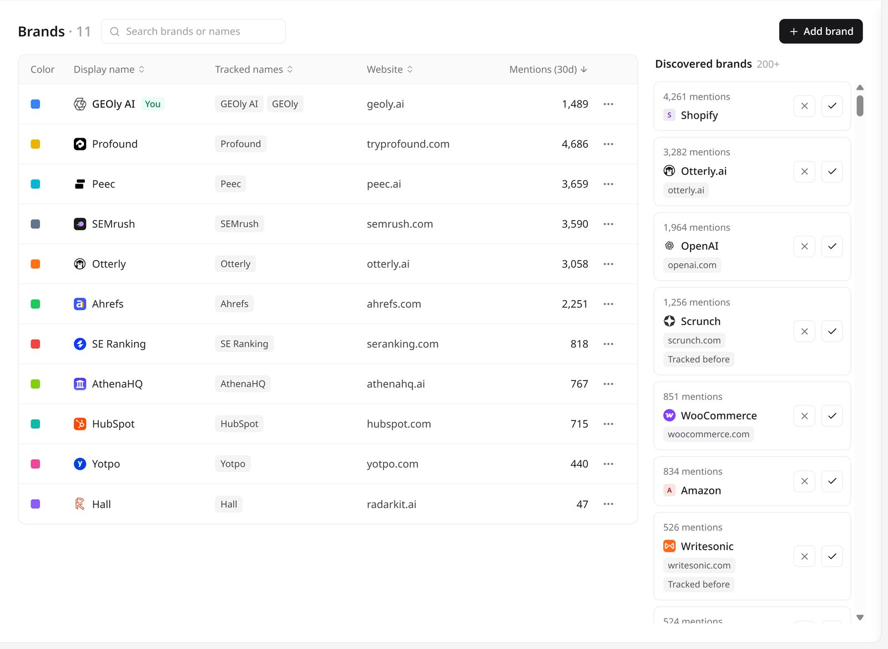
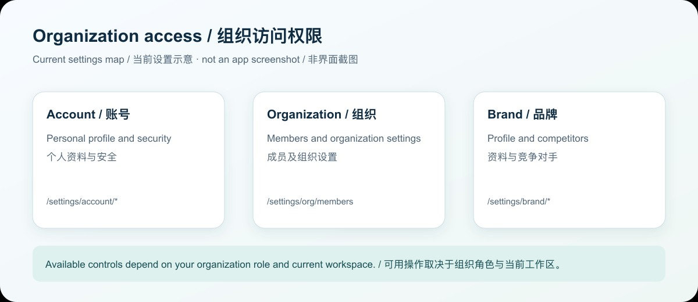
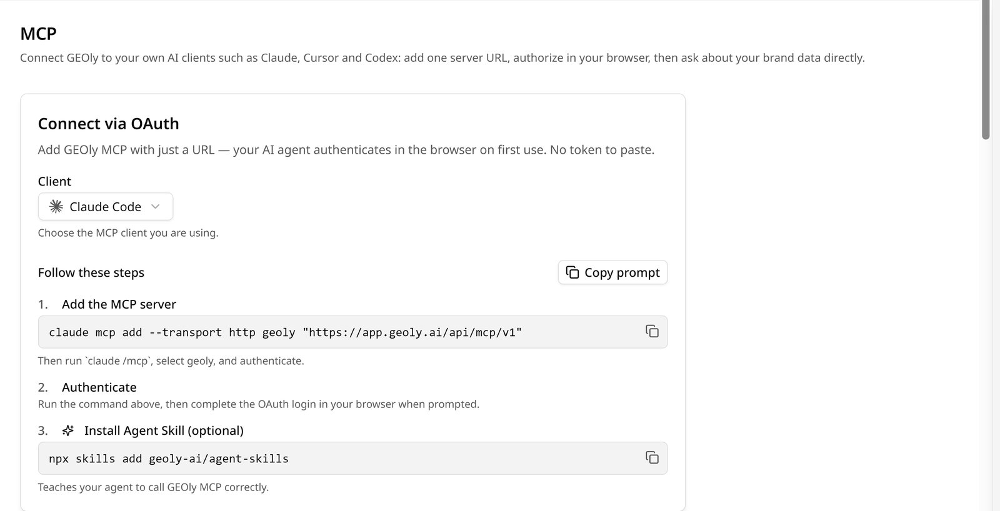

**入口路径：** 登录 GEOly 后，使用左侧导航和当前品牌菜单完成基础配置。

<Note>
本文截图为 GEOly 英文界面，正文按中文界面写页面和按钮名称。
</Note>

这篇指南介绍当前 GEOly 版本中最常用的账号、组织、品牌和监测基础设置。完成这些设置后，GEOly 才能在正确的品牌范围内识别 AI 回答、运行 Monitoring，并让团队成员按权限协作。

## 1. 登录与工作区范围

访问 [app.geoly.ai](https://app.geoly.ai) 并登录。登录后，先确认当前组织、套餐和品牌范围。

- 一个组织可以管理一个或多个品牌，具体可用范围取决于账号和工作区配置。
- 给多个客户品牌做 GEO 的代理商可以用[代理商套餐](/zh/agencies/overview)：套餐规定客户项目个数和一个监测额度总池，总池由你分给各个客户项目。
- 切换品牌后，工作台里的各页面和品牌设置会随当前品牌变化。
- 不要在错误的品牌范围内创建 Prompt、竞品或解读监测结果。

## 2. 切换品牌与打开品牌设置

在左侧导航的项目菜单中，可以查看当前项目、切换已授权项目、选择 **添加项目**（账号有相应权限时），或选择 **管理项目** 进入当前项目的设置。

品牌切换只改变当前查看和操作的品牌范围，不会把不同品牌的数据合并。切换后先确认页面显示的品牌名称，再继续操作。

## 3. 配置品牌资料

打开 **设置 → 项目 → 资料**。页面顶部显示品牌名称、官网和 Logo；下面的内容由系统从官网读取，可直接修改。AI 助手和提示词生成按这些内容理解你的品牌：

- **描述**：用一两句话说明品牌做什么。
- **品类**：你所在的细分品类，不是大行业。
- **品牌调性**：描述品牌风格的关键词。
- **产品与服务**：你们提供的产品和服务。
- **用户画像**：你的客户是谁。
- **目标市场**：品牌在哪些国家经营，以及每个国家的提示词用哪种语言；通过 **在提示词里修改** 调整。
- **受众配比**：你的受众由哪几类人组成。

GEOly 在 AI 回答里识别品牌所用的名称不在这一页，而是作为 **跟踪名称** 在 **设置 → 项目 → 品牌列表** 中管理。

### 跟踪名称怎么填

建议加入官方品牌名、大小写或拼写变体、重要产品线和常见简称。例如：Acme, ACME, Acme Drones。

不要加入与品牌无关的通用词，否则可能增加误识别。保存后，在后续监测结果中检查识别是否准确。

### 关于官网

资料页顶部显示的官网是项目的官方站点。它不等于所有 AI 回答中的引用来源，也不能单独证明网站获得了 AI 推荐。

## 4. 管理跟踪的品牌

打开 **设置 → 项目 → 品牌列表**。列表里有本品牌（标为「你」）和正在跟踪的竞品，列出 **显示名**、**跟踪名称**、**官网** 和 **近 30 天提及**。

- 点击 **添加品牌** 跟踪一个竞品，再填写它的跟踪名称和官网。
- 右侧 **发现的品牌** 会推荐在 AI 回答里经常出现的品牌，可以把它加进列表，也可以不再提示。
- 在每个品牌的 **⋯** 菜单里选择 **编辑** 修改名称或官网，或选择 **不再跟踪** 移除不再相关的品牌。

GEOly 按跟踪名称在 AI 回答中做匹配：

- 添加确实需要比较的品牌；
- 使用稳定、可识别的名称；
- 补充常见的其他叫法，减少漏匹配。

竞品列表用于比较 AI 回答中的品牌出现和相关表现，不代表 GEOly 自动发现了整个市场，也不等于完整的市场竞争排名。

## 5. 组织与账号权限

进入“设置”后，侧栏会切换为设置空间：品牌资料与品牌列表归属品牌；套餐与账单、组织设置和成员归属组织；个人资料与安全归属账号。开发者的 API 密钥和 MCP 接入在独立分组中管理。组织所有者或管理员才能执行相应管理操作，界面与权限校验均以当前账号为准。

上图仅说明设置范围；实际可用管理操作仍以当前组织角色和界面权限为准。

当前工作区显示的组织、套餐和账号权限决定了你可以查看哪些品牌，以及哪些设置和操作可用。不同组织或账号可能看到不同的品牌列表、管理入口和数据范围。

使用团队协作时：

- 先确认成员进入的是正确组织；
- 再确认当前品牌和数据范围；
- 只授予完成任务所需的访问和操作权限；
- 如果某个团队或成员管理入口未出现在当前界面，以工作区实际显示为准，不要把其他账号的菜单当作通用功能。

权限范围会影响成员能看到的品牌、Monitoring 数据和可执行操作。涉及组织、成员或权限的变更，应由当前工作区中拥有相应权限的账号完成。

### 选择监控的 AI 平台

Basic 从 4 个 AI 平台中任选 1 个，Grow 任选 2 个，Advanced 和 Plus 监控全部 4 个。建项目时会先选一次，之后要改：

1. 打开 **设置 → 组织 → 套餐与账单**。
2. 在 **监控覆盖** 卡片上点 **选择平台**。
3. 在套餐上限内选好平台，保存。

改动从下一次每日采集开始生效，移除的平台已有数据仍然可以查看。平台 7 天只能换一次，只有组织所有者和管理员能改。

由 GEOly 或代理商统一配置平台的组织（比如 Enterprise）不显示这个按钮。用[代理商套餐](/zh/agencies/overview)的组织，到 **设置 → 组织 → 全部项目** 里逐个项目选平台，见[监测额度](/zh/agencies/tracking-credits)。想监控的平台比套餐上限多，需要升级套餐。

## 6. MCP 与外部 AI 客户端

当前 MCP 入口是：

**设置 → 开发者 → MCP 接入**

面向支持 OAuth 的外部 AI 客户端，推荐使用远程 MCP URL + OAuth，首次使用时在浏览器完成认证。需要服务端脚本或 API 接入时，组织所有者或管理员还可在“设置 → 开发者 → API 密钥”创建绑定单个项目、指定权限与有效期的密钥；密钥仅完整显示一次，保存在自己的秘密管理系统中。在该页面选择客户端，并复制页面生成的命令或配置；页面上的客户端配置和 OAuth 提示是当前版本的准确信息。具体客户端配置和 OAuth 权限请参阅 [GEOly MCP 使用指南](/zh/developers/mcp/introduction)。

MCP 授权决定外部客户端可以读取或写入哪些 GEOly 资源；品牌设置决定当前品牌的基础资料和识别品牌所用的名称。两者不是同一套权限。

## 7. 推荐的首次配置顺序

1. 登录并确认组织、当前品牌和套餐范围。
2. 打开 **设置 → 项目 → 资料**，检查描述、品类、产品与服务和目标市场。
3. 打开 **设置 → 项目 → 品牌列表**，检查跟踪名称。
4. 添加需要持续比较的竞品，或从 **发现的品牌** 中添加。
5. 创建或检查 Monitoring 的 Prompt、平台和时间范围。
6. 用一条只读查询验证品牌识别和返回范围。
7. 需要接入外部 AI 客户端时，从 **设置 → 开发者 → MCP 接入** 发起 OAuth 授权。

## 8. 常见问题与边界

- 品牌没有被识别，可能是跟踪名称缺失、拼写不同、数据覆盖不足或查询范围不一致。
- 竞品没有出现，不一定代表竞品不存在，也可能是名称匹配、平台、语言、时间范围或样本造成的。
- AIGVR、Mention Rate 和 Citation Rate 属于自有 Monitoring 数据，不应与公共行业研究中的 SoM、AI traffic 或估算营收混用。
- 品牌资料、竞品和跟踪名称的修改不会自动证明排名、流量、转化或收入发生变化。
- 重要结论应回到原始 AI 回答、官网信息和第一方业务数据核对。

完成基础设置后，建议先运行一轮只读 Monitoring，再根据结果调整跟踪名称、跟踪的品牌和 Prompt 范围。
