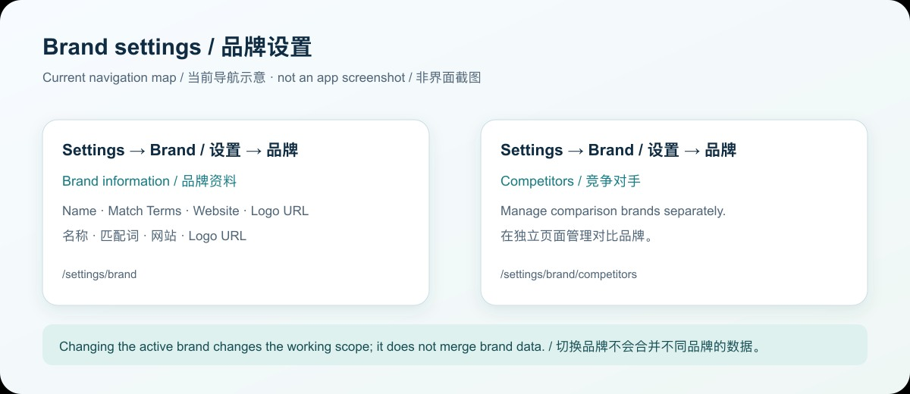
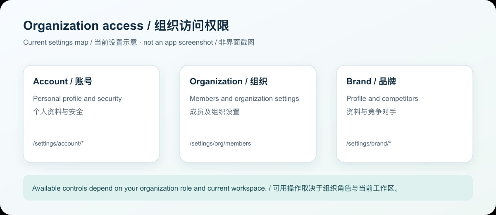
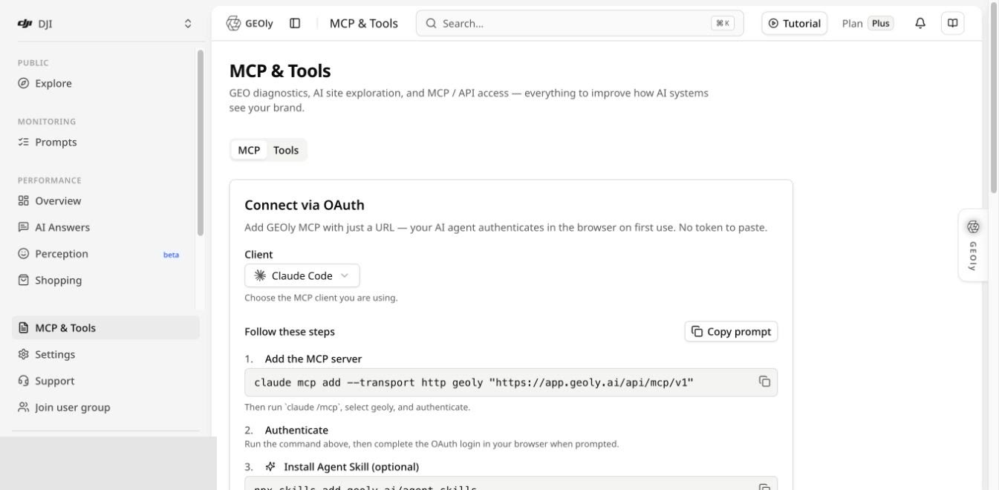

**入口路径：** 登录 GEOly 后，使用左侧导航和当前品牌菜单完成基础配置。

这篇指南介绍当前 GEOly 版本中最常用的账号、组织、品牌和监测基础设置。完成这些设置后，GEOly 才能在正确的品牌范围内识别 AI 回答、运行 Monitoring，并让团队成员按权限协作。

## 1. 登录与工作区范围

访问 [app.geoly.ai](https://app.geoly.ai) 并登录。登录后，先确认当前组织、套餐和品牌范围。

- 一个组织可以管理一个或多个品牌，具体可用范围取决于账号和工作区配置。
- 切换品牌后，提示词、表现和信源 以及品牌资料会随当前品牌变化。
- 不要在错误的品牌范围内创建 Prompt、竞品或解读监测结果。

## 2. 切换品牌与打开 Brand settings

在左侧导航的品牌菜单中，可以查看当前品牌、切换已授权品牌、选择 **Add Brand**（如果账号有相应权限），或进入 **Brand settings** 管理当前品牌。

品牌切换只改变当前查看和操作的品牌范围，不会把不同品牌的数据合并。切换后先确认页面显示的品牌名称，再继续操作。

## 3. 配置品牌资料与识别规则

当前 **Brand settings** 页面包含：

- **Brand Name**：品牌显示名称。
- **Match Terms**：识别 AI 回答中品牌提及的名称、别名、产品名和拼写变体，多个词用逗号分隔。
- **Website**：品牌官方站点 URL。
- **Logo URL**：可选；留空时使用网站 favicon。
- **竞争对手**：在设置侧栏的独立“竞争对手”页面管理，避免把竞品名称混入自有品牌匹配词。

上图展示当前设置空间的页面分工，是导航示意图，不是应用界面截图。

### Match Terms 怎么填

建议加入官方品牌名、大小写或拼写变体、重要产品线和常见简称。例如：dji, DJI, Osmo, Mavic。

不要加入与品牌无关的通用词，否则可能增加误识别。保存后，在 Monitoring 结果中检查识别是否准确。

### Website 怎么填

填写品牌官方站点 URL 并确认域名正确。Website 是品牌资料的一部分，但不等于所有 AI 回答中的引用来源，也不能单独证明网站获得了 AI 推荐。

## 4. 管理竞争对手

从 **设置 → 品牌 → 竞争对手** 进入竞品管理，添加需要持续观察的竞争品牌；品牌资料与竞品是设置空间中的两个独立页面。

GEOly 的竞品识别基于配置的品牌名称和别名进行文本匹配：

- 添加确实需要比较的品牌；
- 使用稳定、可识别的名称；
- 定期删除不再相关的竞品；
- 补充常见别名，减少漏匹配。

竞品列表用于比较 AI 回答中的品牌出现和相关表现，不代表 GEOly 自动发现了整个市场，也不等于完整的市场竞争排名。

## 5. 组织与账号权限

进入“设置”后，侧栏会切换为设置空间：品牌资料与竞争对手归属品牌；套餐与账单、组织设置和成员归属组织；个人资料与安全归属账号。开发者的 API 密钥在独立分组中管理。组织所有者或管理员才能执行相应管理操作，界面与权限校验均以当前账号为准。

上图仅说明设置范围；实际可用管理操作仍以当前组织角色和界面权限为准。

当前工作区显示的组织、套餐和账号权限决定了你可以查看哪些品牌，以及哪些设置和操作可用。不同组织或账号可能看到不同的品牌列表、管理入口和数据范围。

使用团队协作时：

- 先确认成员进入的是正确组织；
- 再确认当前品牌和数据范围；
- 只授予完成任务所需的访问和操作权限；
- 如果某个团队或成员管理入口未出现在当前界面，以工作区实际显示为准，不要把其他账号的菜单当作通用功能。

权限范围会影响成员能看到的品牌、Monitoring 数据和可执行操作。涉及组织、成员或权限的变更，应由当前工作区中拥有相应权限的账号完成。

## 6. MCP 与外部 AI 客户端

当前 MCP 入口是：

**左侧导航 → MCP & Tools → MCP**

面向支持 OAuth 的外部 AI 客户端，推荐使用远程 MCP URL + OAuth，首次使用时在浏览器完成认证。需要服务端脚本或 API 接入时，组织所有者或管理员还可在“设置 → 开发者 → API 密钥”创建绑定单个品牌、指定权限与有效期的密钥；密钥仅完整显示一次，保存在自己的秘密管理系统中。进入 MCP 标签后选择客户端，并复制当前页面生成的配置；页面上的客户端配置和 OAuth 提示是当前版本的准确信息。具体客户端配置和 OAuth 权限请参阅 [GEOly MCP 使用指南](/zh/developers/mcp/introduction)。

MCP 授权决定外部客户端可以读取或写入哪些 GEOly 资源；Brand settings 决定当前品牌的基础资料和识别规则。两者不是同一套权限。

## 7. 推荐的首次配置顺序

1. 登录并确认组织、当前品牌和套餐范围。
2. 打开 **Brand settings**，检查 Brand Name、Website 和 Logo URL。
3. 补充 Match Terms 并保存。
4. 添加需要持续比较的 Competitors。
5. 创建或检查 Monitoring 的 Prompt、平台和时间范围。
6. 用一条只读查询验证品牌识别和返回范围。
7. 需要接入外部 AI 客户端时，从 **MCP & Tools → MCP** 发起 OAuth 授权。

## 8. 常见问题与边界

- 品牌没有被识别，可能是 Match Terms 缺失、拼写不同、数据覆盖不足或查询范围不一致。
- 竞品没有出现，不一定代表竞品不存在，也可能是名称匹配、平台、语言、时间范围或样本造成的。
- AIGVR、Mention Rate 和 Citation Rate 属于自有 Monitoring 数据，不应与公共行业研究中的 SoM、AI traffic 或估算营收混用。
- 品牌资料、竞品名称和 Match Terms 的修改不会自动证明排名、流量、转化或收入发生变化。
- 重要结论应回到原始 AI 回答、官网信息和第一方业务数据核对。

完成基础设置后，建议先运行一轮只读 Monitoring，再根据结果调整 Match Terms、竞品列表和 Prompt 范围。
