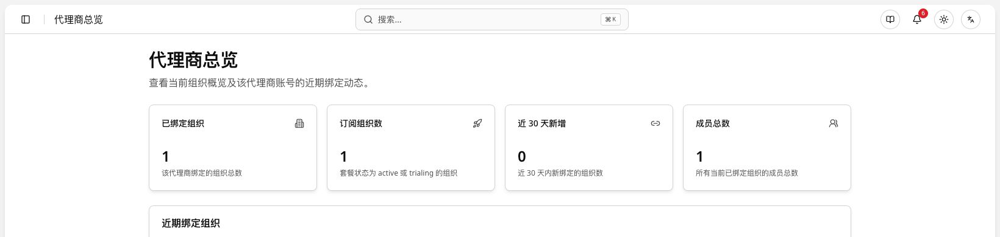
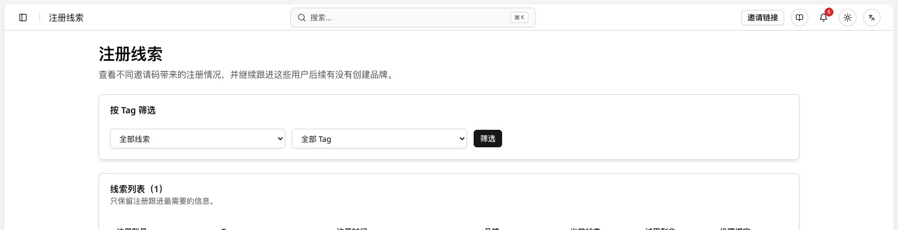
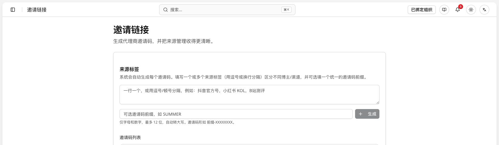
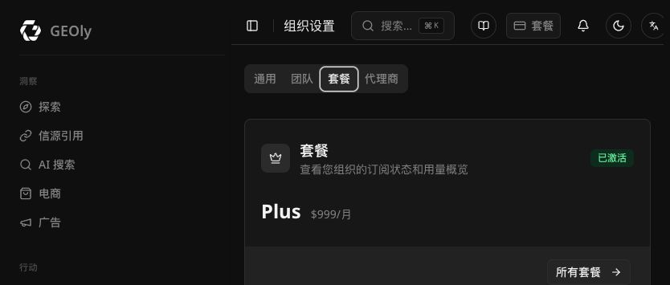
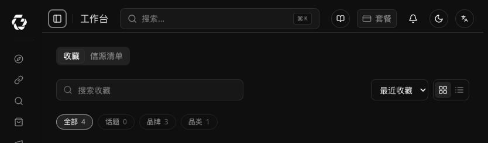

> 本文用于说明 GEOly 代理商工作台、客户组织绑定和套餐管理流程。
>
> 文中标记为「待确认」的内容，需要产品或研发根据当前线上界面、权限配置和计费逻辑确认后再发布。

## 适用对象与入口

本文适用于已通过 GEOly 合作伙伴审核、并已开通代理商工作台权限的代理商。

成为代理商前，请先通过 [GEOly 全球合作伙伴计划](https://www.geoly.ai/zh/partners) 提交申请，或联系 `geo@geoly.ai`。申请通过后，平台管理员会为账号开通代理商权限并配置余额。

登录地址：[GEOly 登录页](https://app.geoly.ai/auth/login)

如果登录后没有看到代理商工作台，请先退出账号并重新登录；仍无法进入时，请联系 GEOly 管理员确认权限是否已生效。

## 1. 核心概念

本文统一以「组织」作为代理商绑定和套餐管理的主体。品牌属于组织内的业务实体；除非页面明确显示品牌级操作，否则不要将“绑定组织”和“绑定品牌”混用。

| 概念 | 说明 |
| --- | --- |
| 账号（Account） | 用户用于登录 GEOly 的个人账号。一个账号可以参与多个组织。 |
| 组织（Organization / Org） | 计费、套餐和成员权限的归属单位。组织可以包含一个或多个品牌。 |
| 项目（Project） | 组织内的监测单元：监测 1 个自有品牌及其竞品（代理商门户里暂时仍显示为「品牌」）。项目数量受组织套餐限制。 |
| 代理商（Agency） | 由 GEOly 平台审核并开通代理商工作台的合作伙伴。 |
| 绑定关系（Binding） | 代理商与客户组织之间的托管关系，不是代理商与单个品牌或客户账号的关系。 |
| 套餐（Plan） | 组织可使用的功能、项目数、席位、Prompt、Responses 和 AI Credits 等权益集合。 |
| 余额（Balance） | 代理商充值后用于为客户组织分配套餐的可用额度。具体单位和扣费规则以平台配置为准。 |
| 商家注册链接 | 用于尚未注册 GEOly 的客户。注册链接用于注册归因，客户完成注册和组织创建后再完成绑定。 |
| 绑定链接 | 用于已注册客户，打开后进入代理商绑定确认流程。 |
| 绑定码 | 用于已注册客户手动输入并校验代理商身份。 |

> **重要：代理商邀请码和个人品牌邀请码不是同一种邀请码。**
>
> 代理商邀请码用于建立“代理商 ↔ 客户组织”的合作绑定关系，后续由代理商为客户组织分配套餐；个人品牌邀请码用于建立“个人/账号 ↔ 某个品牌”的品牌归属或邀请关系。两者的使用入口、绑定对象和生效结果不同，不能互换，也不能用个人品牌邀请码代替代理商邀请码。

### 1.1 绑定关系的基本规则

- 绑定主体是客户组织，客户组织内的品牌不应被单独拆成多条代理商关系。
- 代理商邀请码的绑定对象是客户组织；个人品牌邀请码的绑定对象是个人账号与品牌。发送或输入邀请码前，必须先确认邀请码类型和绑定对象。
- 绑定只能由客户组织的 Owner 或 Admin 发起确认；代理商不能主动认领客户组织。
- 客户组织存在有效 Stripe 自费订阅时，不能直接绑定代理商。
- 已绑定代理商的客户组织不能自行创建或购买 Stripe 自费订阅。
- 代理商自己的组织或品牌不能使用自己的代理商码完成自绑定。
- 非组织 Owner/Admin 的成员没有发起绑定的权限。

### 1.2 账号、组织和工作台切换

一个用户可能同时拥有普通工作台和代理商工作台，也可能属于多个组织。进行操作前，请先确认：

1. 当前登录账号是否为正确账号。
2. 当前是否处于代理商工作台。
3. 当前选择的客户组织是否为要操作的组织。
4. 当前用户是否拥有该组织的 Owner 或 Admin 权限。

> 待确认：当前产品中“组织切换器”“用户个人资料”“品牌中心”和“设置 → 组织设置 → 代理商”的最终菜单名称及路径，需要统一后再发布截图和文字。

## 2. 成为代理商和激活工作台

### 2.1 申请代理商权限

1. 在合作伙伴申请页面提交公司简介、主要服务行业、期望合作区域、联系人及微信号。
2. 或将上述信息发送至 `geo@geoly.ai`，邮件标题建议使用：`GEOly 合作伙伴申请 + 公司简称`。
3. 申请审核通过后，由 GEOly 管理员为账号开通代理商工作台权限。
4. 管理员根据合作安排为代理商账户充值余额。

### 2.2 新账号激活

1. 访问 [GEOly 注册页](https://app.geoly.ai/auth/register) 注册 GEOly 账号。
2. 按系统引导创建或绑定自己的组织和品牌。
3. 联系 GEOly 管理员申请代理商工作台权限。
4. 权限通过后退出当前账号并重新登录。
5. 在工作台切换入口中进入代理商工作台。

### 2.3 已有账号激活

1. 使用已有 GEOly 账号登录。
2. 联系 GEOly 管理员申请代理商工作台权限。
3. 权限通过后退出当前账号并重新登录。
4. 在工作台切换入口中进入代理商工作台。

新账号和已有账号的差异只在账号和组织是否已经存在；代理商权限开通和工作台切换规则相同。

## 3. 代理商工作台

### 3.1 代理商总览

代理商总览用于查看客户组织、订阅状态、余额和近期绑定动态。

建议展示并明确以下指标：

| 指标 | 定义 |
| --- | --- |
| 已绑定组织 | 当前与该代理商存在有效绑定关系的客户组织数量。 |
| 订阅组织数 | 套餐状态为 `active` 或 `trialing` 的客户组织数量。 |
| 近 30 天新增绑定 | 过去 30 个自然日内首次建立绑定关系的客户组织数量。 |
| 品牌总数 | 所有已绑定组织内的品牌数量；不要与绑定组织数量混淆。 |
| 成员总数 | 所有已绑定组织内的成员数量。需要明确是否包含代理商成员。 |
| 当前余额 | 当前可用于套餐分配的余额。币种和更新时间应在页面显示。 |

> **余额/积分注释：截图中的 `2000` 是代理商账户充值后的可用积分余额示例，不是系统默认赠送或初始额度。实际数值以充值记录、套餐分配扣除记录和代理商工作台显示为准。**

### 3.2 近期绑定列表

每条记录建议展示：

- 组织名称；
- 组织内品牌数量或品牌摘要；
- 当前套餐及计费周期；
- 套餐状态：`active`、`trialing`、已过期或 Free；
- 绑定时间和最近更新时间；
- 可用操作：查看详情、分配套餐、解除绑定（需权限）。

页面上的时间应明确时区和格式，例如：`2026-07-20 14:30（Asia/Shanghai）`。

### 3.3 已绑定组织

支持按以下维度筛选：

- 组织名称；
- 品牌名称或域名；
- 套餐；
- 套餐状态；
- 客户 Owner/Admin 邮箱；
- 绑定时间。

组织详情至少应说明：

- 组织名称和组织 ID；
- 组织内品牌及品牌数量；
- 成员数量和主要联系人；
- 当前套餐、计费周期和到期时间；
- 绑定时间、更新时间；
- 最近一次套餐变更和余额变动；
- 当前代理商操作权限。

> 待确认：代理商能否查看客户邮箱、成员列表、Prompt、报告和消耗明细，需要按权限和隐私要求明确列出。

### 3.4 注册线索

商家注册链接带来的新客户，在完成组织创建和绑定前，应显示在“注册线索”页面或对应列表中。

建议记录以下字段：

| 字段 | 说明 |
| --- | --- |
| 客户账号 | 注册邮箱或账号标识。 |
| 注册时间 | 客户通过代理商注册链接完成注册的时间。 |
| 组织状态 | 未创建组织、已创建未绑定、已绑定或已失效。 |
| 归因来源 | 对应代理商或渠道码。 |
| 最近更新时间 | 最近一次注册、创建组织或绑定行为发生的时间。 |

> 待确认：注册线索的归因有效期、重复注册处理、线索失效时间和转化后的保留规则。

### 3.5 邀请链接和绑定码

代理商应在“邀请链接”页面获取三类邀请入口：

| 方式 | 适用客户 | 客户最终动作 |
| --- | --- | --- |
| 商家注册链接 | 尚未注册 GEOly 的客户 | 注册账号、创建组织和品牌，并完成绑定确认。 |
| 绑定链接 | 已注册 GEOly 的客户 | 登录后进入代理商绑定确认页，确认组织和代理商信息。 |
| 绑定码 | 已注册 GEOly、需要手动操作的客户 | 在组织设置中的代理商入口输入绑定码并确认。 |

> **邀请码类型注释：这里使用的是代理商邀请码，不是个人品牌邀请码。**
>
> 如果客户拿到的是个人品牌邀请码，应回到个人品牌邀请流程处理；不要将其输入代理商绑定入口。代理商邀请码校验成功后，页面应展示代理商名称、客户组织名称和绑定关系说明，供客户确认。

#### 3.5.1 生成和发送代理商邀请码

1. 进入代理商工作台的“邀请链接”或“邀请管理”页面。
2. 找到代理商专用的邀请入口，确认页面标识为“代理商邀请码/绑定码”，不要选择个人品牌邀请码。
3. 点击“生成邀请码”或复制系统已经生成的代理商邀请码。
4. 发送前核对代理商名称、适用客户类型和使用说明。
5. 将代理商邀请码、绑定链接或商家注册链接通过私密渠道发送给客户。
6. 告知客户：代理商邀请码用于绑定客户组织，个人品牌邀请码不能用于代理商绑定或套餐分配。

> 待确认：当前页面的实际按钮名称是“生成邀请码”“生成绑定码”还是系统自动生成；发布前应以线上界面为准，并补充对应截图。

#### 3.5.2 邀请码和邀请链接管理

代理商应在邀请管理页面区分以下状态：

| 管理事项 | 代理商需要确认的内容 |
| --- | --- |
| 查看 | 当前邀请码属于哪个代理商、创建时间、使用状态和关联注册线索。 |
| 复制 | 复制前确认是代理商邀请码，不是个人品牌邀请码。 |
| 重新生成 | 重新生成后旧邀请码是否立即失效。 |
| 撤销 | 是否可以主动撤销未使用的邀请码或邀请链接。 |
| 有效期 | 邀请码和链接的有效时间，以及过期后的客户提示。 |
| 使用次数 | 是否一次性使用，或允许多个客户使用。 |
| 追踪 | 查看客户是否已注册、创建组织、完成绑定和等待套餐分配。 |
| 安全 | 不在公开网页、群聊或客户不可控的公共渠道发布邀请码。 |

如果客户反馈邀请码无效，先让客户确认邀请码类型和当前组织，再重新获取代理商页面中的最新邀请码；不要让客户尝试个人品牌邀请码。

> 待确认：重新生成、撤销、有效期、使用次数和注册归因规则需要根据实际产品实现补齐，不能仅凭代理商手册推测。

代理商发送邀请前，应确认客户收到的是正确组织和正确代理商的邀请。不要在公开渠道发布绑定码。

> 待确认：绑定码和绑定链接是否有有效期、是否可重复使用、刷新后旧码是否立即失效、是否支持撤销，以及每个代理商可绑定的组织数量。

## 4. 套餐分配

### 4.1 可分配套餐

下表为官网当前公开套餐配置参考。代理商实际可选择的套餐、价格和余额扣除金额，以代理商工作台的套餐弹窗为准。

| 套餐 | 项目数 | 席位 | 监控 Prompts | AI 平台 | 每月 Responses | 每月 AI Credits |
| --- | ---: | ---: | ---: | --- | ---: | ---: |
| Basic | 1 | 1 | 30 | ChatGPT | 900 | 3,000 |
| Grow | 1 | 2 | 50 | ChatGPT、Google AI Mode | 3,000 | 10,000 |
| Advanced | 1 | 4 | 100 | 4 个平台 | 12,000 | 30,000 |
| Plus | 5 | 10 | 500 | 4 个平台 | 60,000 | 100,000 |
| Enterprise | 定制 | 定制 | 定制 | 全部平台及新平台优先接入 | 定制 | 定制 |

Basic 套餐公开页面显示提供 3 天免费试用。Enterprise 由 GEOly 平台管理员或销售团队独立配置，代理商侧不可直接选择。

参考：[官网当前定价](https://www.geoly.ai/zh/pricing)。

> 说明：下图是客户侧“组织设置 → 套餐”的订阅状态示例，仅用于帮助客户识别套餐状态；代理商实际可分配的套餐、价格和余额扣除金额，以代理商工作台为准。

### 4.2 分配前检查

分配套餐前确认：

1. 当前选择的是正确客户组织。
2. 客户组织已经创建至少一个品牌。
3. 客户组织没有有效 Stripe 自费订阅。
4. 代理商余额足够覆盖本次套餐分配。
5. 选择了正确的套餐和计费周期。
6. 已向客户说明套餐权益、试用期、到期和续费规则。

### 4.3 分配步骤

1. 进入“已绑定组织”。
2. 找到目标组织并打开详情。
3. 点击“套餐分配”。
4. 选择套餐档位和计费周期（月付或年付）。
5. 查看预计扣除余额和客户获得的权益。
6. 确认后点击“保存套餐”。
7. 返回组织详情，核对套餐状态、余额和生效时间。

保存成功后，客户组织权益应即时更新。若余额扣除成功但权益未更新，不要重复点击保存，应记录组织 ID、操作时间和交易信息后联系管理员。

### 4.4 套餐变更和续期

以下规则需要在页面和文档中明确：

- 升级是否立即生效；
- 降级从当前周期还是下一个周期生效；
- 升级或降级是否按剩余周期折算；
- 年付套餐是否享受公开页面显示的 10% 折扣；
- 试用期结束后的套餐状态；
- 余额不足时是否自动暂停、降级或保持当前权益；
- 套餐到期后组织回落到 Free 还是只读状态；
- 续期由代理商自动扣余额，还是由管理员手动操作。

## 5. 客户绑定流程

客户通过代理商渠道进入 GEOly 后，推荐遵循以下顺序：

1. 注册或登录 GEOly 账号。
2. 创建或选择客户组织。
3. 在组织内创建或绑定品牌档案。
4. 使用代理商注册链接、绑定链接或代理商邀请码完成绑定。
5. 由客户组织 Owner/Admin 确认绑定。
6. 代理商在“已绑定组织”中核对客户信息。
7. 代理商为客户组织分配套餐。

> **注意：客户应先完成组织和品牌档案的创建，再由代理商分配套餐。**如果客户已经通过 Stripe 自费订阅，不能直接套用代理商绑定流程；应先确认取消、迁移和剩余权益规则。

### 5.2 全新客户：商家注册链接

适用于尚未注册 GEOly 的客户。

1. 代理商复制商家注册链接并发送给客户。
2. 客户通过链接注册 GEOly 账号。
3. 客户创建组织和品牌，或在创建组织时输入代理商邀请码（如页面提供该入口）。
4. 客户确认代理商、组织和套餐管理关系。
5. 绑定完成后，客户组织出现在代理商的“注册线索”和“已绑定组织”页面。
6. 代理商为组织分配套餐。

### 5.3 已注册客户：绑定链接

适用于已经注册 GEOly、但尚未绑定代理商的客户。

1. 代理商复制绑定链接并发送给客户。
2. 客户登录 GEOly 后打开链接。
3. 页面展示代理商名称和待绑定组织。
4. 客户使用 Owner 或 Admin 权限确认绑定。
5. 绑定成功后，客户组织进入代理商的“已绑定组织”。

如果绑定链接在已有登录会话下没有打开正确组织，客户应退出账号后重新通过绑定链接登录，再重试绑定确认。

### 5.4 已注册客户：绑定码

1. 代理商在“邀请链接”页面复制绑定码。
2. 客户进入当前组织的代理商设置入口。
3. 输入绑定码并点击“校验代理商”。
4. 核对代理商名称、组织名称和绑定说明。
5. 点击“确认绑定”。
6. 代理商在“已绑定组织”中确认绑定结果。

### 5.5 已注册客户：代理商码创建新组织

适用于客户已有 GEOly 账号，但希望新建一个由代理商托管的组织。

> 此处必须使用**代理商邀请码**。个人品牌邀请码不能用于创建代理商托管组织，也不能用于为组织分配代理商套餐。

1. 客户打开组织切换器并选择“创建组织”。
2. 选择“已有代理商邀请码？”（如当前页面提供该入口）。
3. 输入组织名称和代理商邀请码。
4. 点击“用代理商创建”。
5. 系统创建组织并建立代理商绑定关系，不进入 Stripe 自费订阅流程。
6. 客户确认新组织已出现在组织切换器中。
7. 代理商在“已绑定组织”中及时分配套餐。

在套餐分配完成前，新组织可能只有基础访问权限。页面应明确展示“待代理商分配套餐”的状态。

### 5.6 品牌档案管理边界

代理商手册只说明客户如何完成组织和品牌档案创建，以便代理商完成绑定和套餐交付；不重复品牌方操作手册中的日常使用内容。

客户侧完成组织和品牌创建后，可从“工作台”入口查看已收藏的品牌和品类。代理商负责绑定和套餐交付，不代替品牌方执行日常 GEO 操作。

| 操作 | 代理商手册中的处理方式 |
| --- | --- |
| 创建客户组织 | 说明代理商专属入口和绑定顺序。 |
| 创建或绑定品牌档案 | 说明客户必须完成这一步，代理商负责核对是否已完成。 |
| 修改品牌名称、域名和品牌资料 | 由品牌方按照品牌方操作手册处理。 |
| 配置 Prompt、查看报告和日常 GEO 优化 | 由品牌方按照品牌方操作手册处理；代理商是否能代操作取决于组织权限。 |
| 分配套餐和管理余额 | 由代理商在代理商工作台处理。 |
| 组织绑定、解绑和换绑 | 由客户 Owner/Admin、代理商和 GEOly 管理员按本文流程处理。 |

客户完成组织和品牌档案创建后，如需继续维护品牌资料、Prompt、报告或日常 GEO 功能，请参阅《品牌方操作手册》。

> 待补充：发布正式版本时，在“品牌方操作手册”文字上补充对应 CMS 文档链接。

## 6. 绑定限制和常见报错

| 情况 | 系统行为 | 客户或代理商处理方式 |
| --- | --- | --- |
| 绑定码错误或已失效 | 提示未找到可用绑定码 | 核对字符、重新获取最新绑定码。 |
| 绑定码已被刷新 | 旧码不可用 | 使用代理商“邀请链接”页面中的最新码。 |
| 组织已绑定其他代理商 | 拒绝重复绑定 | 联系 GEOly 管理员处理换绑，不要重复提交。 |
| 组织有有效 Stripe 订阅 | 拒绝绑定 | 先确认取消、迁移和剩余周期处理方式。 |
| 客户不是 Owner/Admin | 无权发起绑定 | 请组织 Owner/Admin 操作。 |
| 代理商绑定自己的组织 | 拒绝自绑定 | 使用客户组织流程，不要使用自己的代理商码。 |
| 组织尚无品牌 | 无法分配套餐 | 客户先创建或绑定品牌。 |
| 余额不足 | 套餐分配失败 | 联系 GEOly 管理员充值后再操作。 |
| 保存后状态未更新 | 可能存在异步处理或交易异常 | 不要重复扣款，保留组织 ID和操作时间并联系管理员。 |

> 待确认：正式上线前应补充错误码、客服入口、管理员联系方式和每种错误的预计处理时效。

## 7. 解除绑定、换绑和套餐权益

### 7.1 解除绑定

解除绑定前，应确认客户组织、当前套餐和客户是否知情。操作路径建议为：

1. 进入“已绑定组织”。
2. 打开目标组织的“套餐分配”弹窗。
3. 在危险操作区域点击“解除绑定”。
4. 阅读确认提示并完成二次确认。
5. 返回列表，确认代理商已失去该组织的可见性和管理权限。

### 7.2 解绑后的处理

当前文档规则为：解除绑定不会立即取消当前周期内已经生效的套餐权益；周期结束后，如果客户没有自有套餐，组织可能回落到 Free 或只读状态。

以下内容必须在产品规则中进一步明确：

- 当前周期的准确结束时间；
- 解绑后客户是否还能继续消耗 Responses、AI Credits 和 Prompt 配额；
- 解绑后的新增消耗是否完全不计入代理商；
- 周期结束后究竟是 Free、只读还是停用；
- 解绑后是否可以绑定新代理商；
- 原代理商是否可以再次绑定；
- 已扣余额是否退款或保留；
- 客户是否会收到解绑通知。

### 7.3 自费订阅迁移

客户组织已有 Stripe 自费订阅时，不应直接绑定代理商。需要由客户、代理商和 GEOly 管理员确认：

1. 订阅取消时间；
2. 剩余周期和未使用权益；
3. 是否退款或抵扣；
4. 代理商套餐的生效时间；
5. Stripe 订阅和代理商余额是否会重复扣费。

## 8. 权限、隐私和安全

### 8.1 权限原则

- 客户组织 Owner/Admin 才能确认绑定。
- 代理商只能查看和管理已建立绑定关系的组织。
- 代理商不能主动认领客户组织。
- 代理商不应获取客户密码、验证码、Stripe 私密信息或 API 密钥。
- 绑定码和绑定链接应通过私密渠道发送，不要公开发布。

> 待确认：代理商工作台是否支持多名代理商成员，以及代理商成员能否充值、分配套餐、解除绑定和查看客户数据，需要补充权限矩阵。

### 8.2 建议补充的审计信息

套餐分配、套餐变更、充值、解绑和换绑操作都建议记录：

- 操作人；
- 操作时间和时区；
- 组织 ID；
- 操作前后套餐；
- 操作前后余额；
- 交易 ID或请求 ID；
- 操作结果和失败原因。

## 9. 代理商日常检查清单

### 新客户绑定前

- [ ] 客户确认绑定的是正确代理商。
- [ ] 客户使用的是目标组织的 Owner/Admin 权限。
- [ ] 组织没有有效 Stripe 自费订阅。
- [ ] 组织至少创建了一个品牌。
- [ ] 代理商余额足够。

### 套餐分配后

- [ ] 套餐档位和计费周期正确。
- [ ] 余额扣除金额正确。
- [ ] 组织套餐状态已更新。
- [ ] 客户可看到对应权益。
- [ ] 已记录操作时间和交易信息。

### 解除绑定前

- [ ] 客户已知悉解绑影响。
- [ ] 已确认当前套餐和剩余周期。
- [ ] 已说明周期结束后的权益状态。
- [ ] 已确认后续是否需要换绑。

## 10. 常见问题

### 代理商能直接绑定客户吗？

不能。代理商可以生成并发送商家注册链接、绑定链接或绑定码，但最终绑定确认必须由客户组织的 Owner 或 Admin 发起。

### 客户有多个组织时，绑定哪个组织？

绑定发生在客户确认时选择的组织上。操作前必须核对组织名称和组织 ID。

> 待确认：当前绑定链接是否支持客户选择组织，还是根据当前登录组织自动绑定。

### 客户已经有 Stripe 订阅怎么办？

不能直接绑定。需要先由客户、代理商和 GEOly 管理员确认订阅取消、剩余周期、退款或迁移规则。

### 解绑后套餐会立即消失吗？

当前文档规则是当前周期内已生效权益继续保留；周期结束后的状态和续费归属，需要以最终产品规则为准。

### 余额不足怎么办？

联系 GEOly 管理员充值。余额不足时不要重复点击套餐分配，避免重复提交或产生不一致记录。

## 11. 发布前必须确认的产品信息

以下信息确认后，才能把本文从草稿发布为正式操作手册：

1. 绑定主体究竟是组织级还是品牌级；
2. 代理商工作台和客户侧的最终菜单路径；
3. 三类邀请入口的生成、刷新、撤销和过期规则；
4. 注册线索页面是否存在及其字段；
5. 代理商 Owner/Admin/Member 权限矩阵；
6. 套餐弹窗实际可选套餐和代理商价格；
7. 月付、年付、试用、升级、降级和续期规则；
8. 余额扣费、失败回滚、退款和交易流水规则；
9. 解绑、换绑和自费订阅迁移规则；
10. 解绑后的当前周期、新增消耗和周期结束状态；
11. 客户通知、审计日志和隐私边界；
12. 正式错误码、客服入口和管理员联系方式；
13. 总览、组织详情、套餐分配、邀请和余额页面截图；
14. 文档适用版本、最后更新时间和变更记录。

---

## 变更记录

| 日期 | 版本 | 说明 |
| --- | --- | --- |
| 2026-07-20 | Draft 0.1 | 补充组织/品牌定义、完整绑定流程、套餐、余额、解绑、权限、安全、错误处理和发布前确认项。 |
