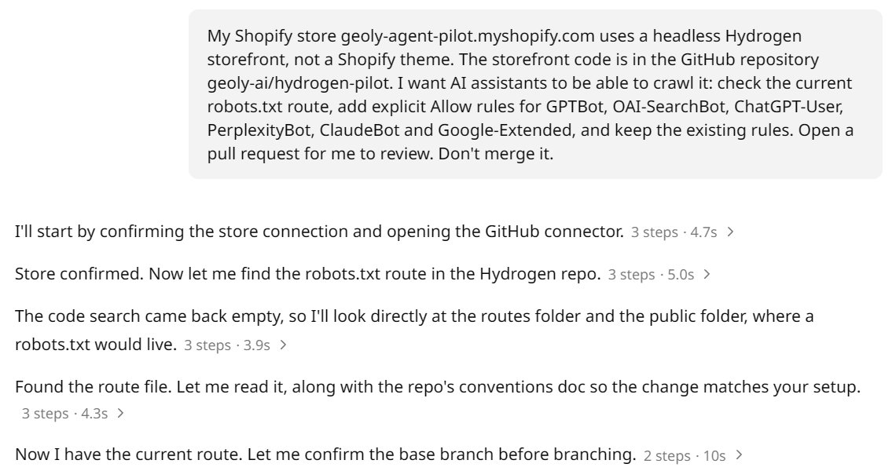
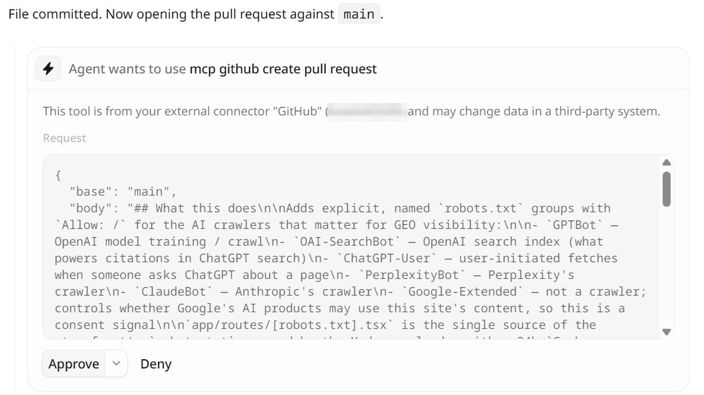
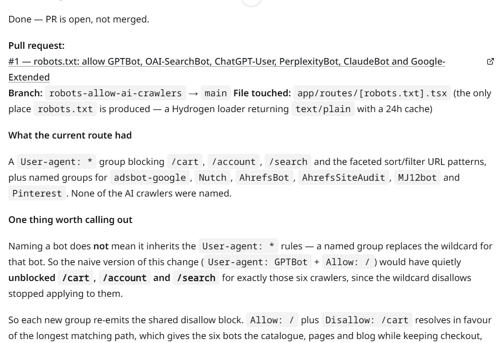
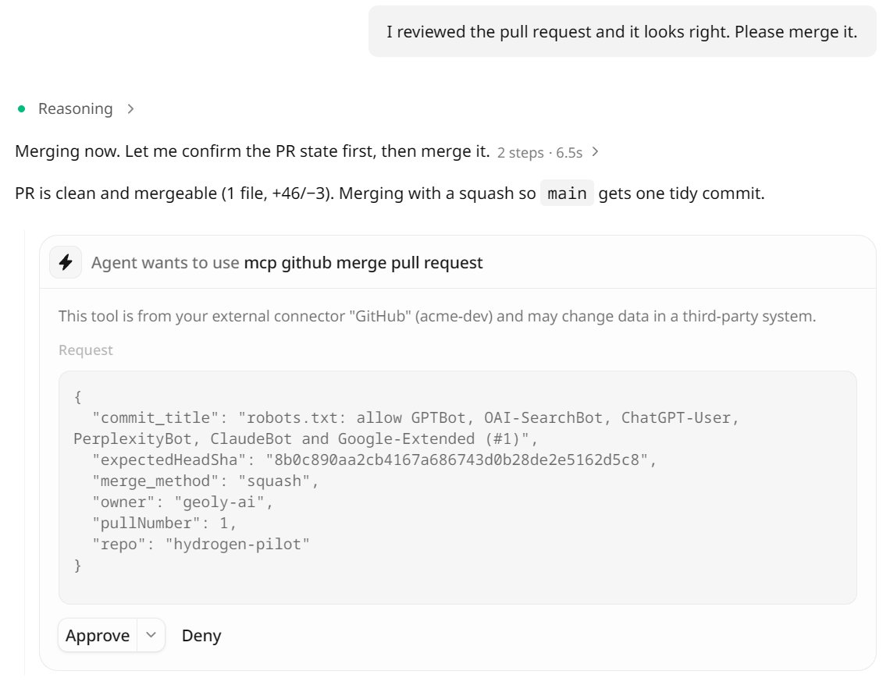

无头店（用 Hydrogen 或其他框架搭的店）里，顾客看到的页面由你自己的代码渲染，不经过 Shopify 主题。商品、页面、博客文章还存在 Shopify 里，网站本身则在你的代码仓库里。GEOly Agent 按东西存在哪里来改：

| 改什么 | 存在哪里 | Agent 怎么改 |
| --- | --- | --- |
| SEO 标题和描述、商品和集合描述、图片 alt、页面、博客文章、元字段、跳转 | Shopify | 你在对话里批准卡片后，直接改进 Shopify，和主题店一样；也可以让 Agent 撤销 |
| `robots.txt`、结构化数据（JSON-LD）、meta 标签等网站代码 | 你的前台代码仓库 | 开一个 PR（GitLab 上叫合并请求）给你审核。PR 合并并部署之前，网站不会变 |

<Note>
内容改动只有在前台代码读了对应字段的地方才看得到。比如 Hydrogen 官方模板的商品页标题是代码里拼出来的，在 Shopify 里改商品的 SEO 标题，页面标题不会跟着变，要等代码改成读 SEO 字段。跳转在 Hydrogen 官方模板里是生效的，因为它会把找不到的路径交给 Shopify 的跳转规则。
</Note>

GEOly 应用的结构化数据和 FAQ 是主题的应用嵌入，在无头店上不显示。无头店的结构化数据由 Agent 写进你的代码。

<Note>
下面的截图都是 GEOly 的英文界面。正文先写英文界面上的名称，括号里是中文界面的对应名称。
</Note>

## 一、开始前准备

开始前请确认：

- 店铺已经在 **Agent › Connectors › Your store**（连接器 › 你的店铺）里连到 GEOly 项目，做法见[让 GEOly Agent 改 Shopify 主题](/zh/shopify/agent-theme-changes)的「开始前准备」；
- 放前台代码的 Git 托管已经在 **Agent › Connectors**（连接器）里连上：
  - **GitHub**：见[连接 GitHub 操作手册](/zh/integrations/github-connector)。要把 GEOly Agent 应用装到前台代码仓库上，没装之前 Agent 看不到私有仓库；
  - **GitLab**（gitlab.com）：在连接器目录里连 **GitLab**；
  - 自己部署的 GitLab 或其他 Git 服务：按[连接器](/zh/agent/connectors)里的「添加自定义 MCP 服务」连上它。

## 二、告诉 Agent 店铺是怎么搭的

Agent 会看项目网站和店铺域名，判断是不是 Shopify 主题渲染的。判断不了的时候它会问你，比如店铺还只有 `myshopify.com` 地址的时候。

告诉它前台是无头店、代码在哪个仓库（写法见第三节的例子）。Agent 接着会弹出 **Update context**（更新上下文）卡片，想把这一条存进项目的 **Context**（上下文）。批准之后，这个项目以后的对话会直接去仓库里改，不用再问。

## 三、在对话里提出改动

新开一个对话，说明店铺是无头店、代码在哪个仓库、要改什么，比如：

> My Shopify store your-store.myshopify.com uses a headless Hydrogen storefront, not a Shopify theme. The storefront code is in the GitHub repository your-org/your-storefront. I want AI assistants to be able to crawl it: check the current robots.txt route, add explicit Allow rules for GPTBot, OAI-SearchBot, ChatGPT-User, PerplexityBot, ClaudeBot and Google-Extended, and keep the existing rules. Open a pull request for me to review. Don't merge it.

用中文说也可以，比如「我的 Shopify 店是 Hydrogen 无头店，代码在 GitHub 仓库 your-org/your-storefront。看一下现在的 robots.txt 路由，给 GPTBot、PerplexityBot、ClaudeBot 等 AI 爬虫加上明确的 Allow 规则，原有规则保留。开个 PR 给我审，先别合并」。

## 四、逐步批准 GitHub 操作

Agent 会先读仓库，找到生成这个页面的文件（Hydrogen 的 `robots.txt` 来自路由 `app/routes/[robots.txt].tsx`），然后建分支、提交改动、开 PR。

GitHub 的每个工具都会弹一张卡片，写明来自你的 GitHub 连接、要做什么。你点 **Approve**（批准）之前什么都不会执行。我们实测时，Agent 先读了 6 次仓库、列了一次分支，再依次请求建分支、提交文件、开 PR。

不想每次读仓库都点批准，可以打开 GitHub 连接，把读取类工具设成 **Always allow**（始终允许）。建分支、提交、合并这类会改东西的工具，建议保留 **Ask**（询问）。见[连接 GitHub 操作手册](/zh/integrations/github-connector)的「在对话里使用」。

## 五、审核 PR

Agent 会给出 PR 链接、分支和改了哪些文件，并说明改动内容。它不会自己合并。

到 GitHub 上审核这个 PR。如果你的托管会给每个 PR 生成预览（Shopify Oxygen 可以），先在预览上看一下效果。

## 六、合并 PR

什么时候上线由你决定：

- **自己合并**：在 GitHub 上合并。
- **让 Agent 合并**：比如说「PR 看过了，没问题，请合并」。Agent 会弹出 **merge pull request** 卡片。卡片里带着你审过的那个提交（`expectedHeadSha`），之后要是有人又往分支上推了东西，这次合并不会成功。

如果仓库的默认分支会自动部署（Oxygen 和大多数托管都是这样），合并就等于上线。部署完成后，在前台实际用的域名上打开页面核对，比如 `https://www.你的店铺.com/robots.txt`。`myshopify.com` 地址不走你的前台代码，看不到这些路由。

## 七、撤销

- **合并前**：在 GitHub 上关掉这个 PR，或者让 Agent 关掉。
- **合并后**：在 GitHub 上已合并的 PR 页面点 **Revert**，或者让 Agent 开一个回退的 PR，再按同样的方式合并。
- **在 Shopify 里改的内容**：让 Agent 撤销，和主题店一样。

## 八、常见问题

- **Agent 要改主题文件或工作副本**：它把你的店当成了主题店。告诉它前台是无头店、代码在哪个仓库，再批准 **Update context**（更新上下文）卡片。
- **Agent 说找不到仓库**：GEOly Agent 应用没装到这个仓库，或者仓库的所有者、名字写错了。在 GitHub 连接里点 **Choose repositories**（选择仓库）把它加上。
- **Agent 把改动写在对话里，没有开 PR**：你的连接都访问不到这个仓库。连上对应的 Git 托管，或者给连接加上这个仓库的权限，再让它做一次。
- **改了内容，网站上没变化**：前台代码没读这个字段。可以让 Agent 开 PR 改代码，让页面用上它。
