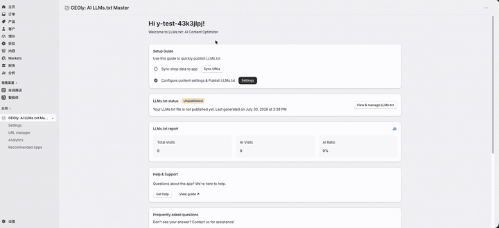
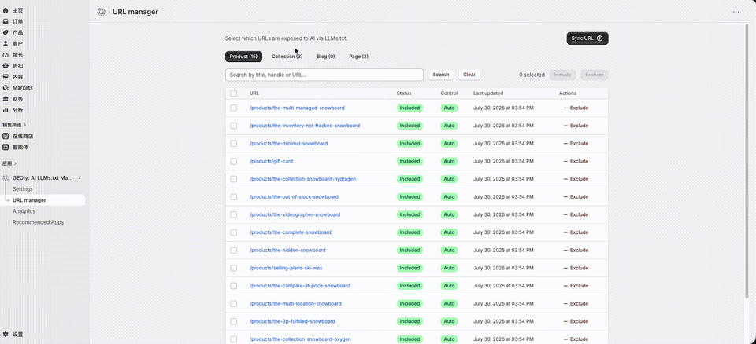

## 开始前：这款应用能做什么？

**GEOly: AI LLMs.txt Master** 会把 Shopify 店铺中的产品、产品系列、博客和页面整理为结构化的 `llms.txt` 文件。你可以决定哪些链接被收录、选择输出字段、发布公开文件，并查看文件的访问数据。

> `llms.txt` 是帮助 AI 系统理解站点内容的辅助文件，不会替代 `robots.txt` 或 `sitemap.xml`，也不能保证内容一定被抓取、引用，或提升搜索排名。

## 一、安装应用并同步店铺数据

1. 在 Shopify 应用商店安装 **GEOly: AI LLMs.txt Master**，并完成授权。
2. 在 Shopify 后台进入 **应用 → GEOly: AI LLMs.txt Master**。
3. 按首页 **Setup Guide** 完成 **Sync shop data to app**。
4. 进入 **URL manager**；需要重新获取资源时，点击 **Sync URL**。
5. 同步完成后，进入 **Settings** 配置并发布文件。

当店铺新增或修改产品、产品系列、博客或页面时，建议重新执行 **Sync URL**，再检查生成内容。

## 二、配置并发布 llms.txt

进入 **Settings** 页面后，依次完成以下设置：

1. **Store description**：填写品牌、主营品类和店铺定位。这段内容会出现在 `llms.txt` 顶部。
2. **AI assistant access**：按需要勾选页面提供的 AI 助手，包括 ChatGPT、Claude、Gemini、Perplexity 和 DeepSeek。
3. **Template & fields**：产品、产品系列、博客和页面的标题与 URL 为固定字段；产品还可选择是否显示价格。
4. **生成内容**：
   - **Generate By System**：根据已同步的产品、产品系列和页面，使用模板快速生成内容。
   - **Generate By Sidekick**：调用 Shopify Sidekick 生成更丰富的内容。进入 Sidekick 后，按应用提示输入 `/llms + language`，例如指定中文或英文。
5. 在 **Generated Content** 中检查并按需编辑 Markdown，重点核对店铺描述、价格、链接和内容层级。
6. 点击 **Save** 保存。设置发生变化时，应用会重新生成文件；你可以在 **Version History** 查看来源与版本，并使用旧版本或固定某个版本。
7. 将发布开关从 **Unpublished** 切换为 **Published**。页面提示 **LLMs.txt is accessible to AI crawlers** 时，表示文件已公开。

页面中的 **Proxy URL** 是应用生成文件的公开地址。应用 FAQ 说明，根路径的 `/llms.txt` 请求会通过 301 重定向指向该地址，因此无需手动修改 Shopify 根目录文件。

> 发布前请排除测试页、重复页面、失效链接，以及任何不希望公开给 AI 的内容。发布状态只表示文件可以访问，不代表第三方 AI 已抓取或采用其中的内容。

## 三、管理 llms.txt 中的链接

进入 **URL manager** 后，可以管理 **Product、Collection、Blog、Page** 四类资源：

1. 使用分类标签或搜索框查找资源。
2. 勾选一条或多条记录。
3. 点击 **Include** 将链接加入 `llms.txt`；点击 **Exclude** 将其排除。
4. 查看 **Status**、**Last updated** 和操作列，确认当前收录状态。
5. 完成调整后，回到 **Settings** 检查 **Generated Content** 并保存。

建议保留公开、稳定、内容完整且有助于理解品牌或商品的核心页面；排除下架商品、内部页面、重复内容和低价值链接。

## 四、查看访问数据

进入 **Analytics** 页面后，可选择 **Last 7 days、Last 14 days** 或 **Last 30 days**，再点击 **Query** 查询对应时间段。

页面主要包括：

- **Total Visits**：记录到的总访问次数。
- **AI Visits**：被应用识别为 AI 的访问次数，并显示其占总访问的比例。
- **Top AI Visitor**：当前时间段内访问最多的 AI 访问者；没有可用记录时会显示 **N/A**。
- **Visitor Distribution**：访问者分布。
- **Daily Visits Trend**：AI Visits、Crawler Visits 和 Total Visits 的每日趋势。
- **Recent Access Logs**：近期访问日志，包括 Time、Provider、Bot Name、Category 和 Path。

应用首页的 **LLMs.txt report** 另有 **AI Ratio** 卡片，用于显示 AI Visits 占 Total Visits 的比例；不要与 Analytics 页面中的 **Top AI Visitor** 混淆。

> 如果趋势图显示 **Demo Data**，图表中的趋势仅为演示数据，不应当作真实访问结果。访问数为 0 也可能是文件刚发布、所选时间段内没有访问，或暂时没有可识别的访问者。

这些数据反映 `llms.txt` 的访问情况，但不等同于 AI 收录、品牌提及、引用、推荐、成交或收入。

## 五、确认 llms.txt 是否正常工作

1. 在应用首页确认 **LLMs.txt status** 为 **Published**。
2. 点击 **View & manage LLMs.txt** 返回设置页。
3. 打开 **Proxy URL**，确认文件可以访问。
4. 对照 **Settings** 和 **URL manager**，检查店铺描述、字段、资源类型和链接是否正确。
5. 如需验证根路径，可访问店铺域名下的 `/llms.txt`，确认它能重定向到应用提供的文件。
6. 在 **Analytics** 中选择时间范围，查看真实指标和 **Recent Access Logs**；如页面标注 **Demo Data**，不要使用该趋势图判断真实访问。

## 六、常见问题

### 发布 llms.txt 后会立即增加排名或 AI 流量吗？

不会。`llms.txt` 只是辅助信号，实际抓取、收录、引用和推荐由第三方平台决定。

### 它会替代 robots.txt 或 sitemap.xml 吗？

不会。三者用途不同，应继续保留现有的搜索引擎抓取和站点地图配置。

### 应该包含所有链接吗？

不需要。优先收录稳定、公开、信息完整的核心页面，并排除失效、重复、测试、内部或低价值页面。不要在公开内容中加入敏感信息。

### Generate By Sidekick 和 Generate By System 有什么区别？

**Generate By System** 更快，适合基于同步资源快速更新；**Generate By Sidekick** 会使用 Shopify Sidekick 生成更丰富、结合上下文的内容。无论采用哪种方式，保存前都应人工核对事实、价格、链接和品牌表述。

### Analytics 能告诉我品牌在 ChatGPT、Gemini 等平台的曝光吗？

不能直接等同。这里的 Analytics 主要统计 `llms.txt` 的访问与已识别的 AI 访问；它不代表 GEOly 品牌监测中的提及率、引用率、可见度或竞品表现。如需分析品牌在 AI 回答中的表现，应使用 GEOly 的品牌监测与分析功能。
